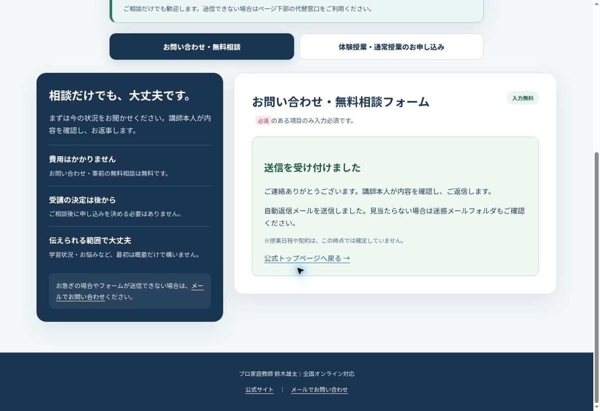

# 5サイト総合監査・改善記録（2026-11-03）

対象：公式、英検、逆転合格、進路伴走、Re:大学受験。改善前は main `21a43719accc84e8c5fd33dcf234ae523258d2a0`。PR: https://github.com/k0nan728-web/kateikyoshi-sogo-official/pull/8 ・ https://github.com/k0nan728-web/kateikyoshi-sogo-official/pull/9

## 評価の読み方

以下は閲覧・ソース・検証結果に基づく監査担当者の暫定評価（100点満点）です。デザインや文章には主観を含み、認証・法的適合性・成果保証を意味しません。100点は未検証事項がなく、要求を全て満たした場合のみとします。実機Safari、実利用者のCore Web Vitals等が未確認のため、総合100点とは判定していません。

| 評価項目 | 公式 前→後 | 英検 前→後 | 逆転 前→後 | 伴走 前→後 | Re: 前→後 |
|---|---:|---:|---:|---:|---:|
| デザイン・視覚的階層 | 78→88 | 80→88 | 78→88 | 60→88 | 60→88 |
| 文章・読みやすさ | 80→88 | 80→88 | 78→88 | 60→88 | 60→88 |
| 料金・追加費用の分かりやすさ | 85→94 | 90→94 | 80→94 | 45→94 | 45→94 |
| 指導内容・対象の明確さ | 85→92 | 90→92 | 85→92 | 65→92 | 65→92 |
| 掲載実績の整合性と説明 | 90→94 | 90→94 | 90→94 | 70→92 | 70→92 |
| 講師紹介・担当者の見え方 | 90→94 | 85→94 | 85→94 | 45→94 | 45→94 |
| 相談・申込導線 | 80→92 | 80→92 | 80→92 | 55→92 | 55→92 |
| SEO・メタデータの実装 | 85→94 | 85→94 | 65→94 | 65→94 | 80→94 |
| アクセシビリティ（自動＋目視範囲） | 80→92 | 88→92 | 78→92 | 75→92 | 75→92 |
| 表示速度（同一CIのモバイルLighthouse） | 35→86 | 49→96 | 86→97 | 73→99 | 76→99 |
| 各機能・障害時動作 | 75→85 | 75→85 | 75→85 | 60→85 | 60→85 |

**暫定総合評価（11項目の単純平均）**：公式 78→91点、英検 81→92点、逆転 80→92点、伴走 61→92点、Re: 63→92点。

速度欄は測定値、その他は改善の判断根拠を示す暫定評価です。項目の単純平均を総合評価とします。速度はCIの非圧縮ローカルHTTP・CPU/回線制限のあるラボ測定で、実利用者のCore Web Vitalsではありません。公式の速度には改善余地があります。全機能の85点は、体験・通常授業の申込実送信等を留保した暫定評価です。お問い合わせの実送信は下記の追加検証で確認済みです。

## 重要度別の問題と対処

### 優先度 高：料金・契約・申込

- 英検の「月4回未満」と「申込総回数4回未満」が混同され得た点を照合。所有者に確認し、総回数4回未満を正式条件として維持。対象試験30日前ちょうど・総4回ちょうどは通常、30日未満または総1〜3回は1.3倍を一度のみ適用。体験は総回数に含めず、受講済み単価の遡及加算なし。
- 比較計算機の大学受験レベル名と公式表の偏差値区分が相違。所有者指定の公式表を基準に、比較サイトの配信JSと元Reactソースを同期。数値料金・計算式は維持。
- 伴走の旧Googleフォーム、専門サイトから遠回りになる申込導線を共通のネイティブフォームへ変更しブランド情報を引継ぎ。
- 伴走・Re:に不足していた正式料金表、追加費用、任意サポート、特典、受講条件、FAQを追加。月額サポート10,000円は任意、入会金・管理費・仲介料0円を明示。
- 授業ごとのキャンセルと契約全体の中途解約を分けて案内。所有者提供の「未受講分−15,000円」「24時間未満は次回分から」「残額0以下は返金なし」を共通原稿から5サイトへ反映。法令の上限・制限、クーリング・オフが優先する注記を追加。新規契約への事前説明を前提とし既存契約に自動遡及しない案内。申込画面から明示的にリンク、通知に条件版を記録。
- 個人間送金が無条件に利用可能と誤解されないよう、各サービスの条件を確認し利用可能な場合のみ個別案内という既存説明に統一。銀行振込先の種類は維持。

### 優先度 中：デザイン・理解・SEO・操作

- 伴走・Re:の説明不足を補い、講師本人の写真・資格・実績数、実際の授業画面、週間計画・報告書の見本、相談から開始までのステップを配置。同形カードの連続を避け、写真と文章、帯、表、FAQを組合せ。資料は見本、有料任意サポートに含む範囲を明示。
- ブランドごとの色は維持し、共通のネイビー・グリーン・アイボリー系の親しみある説明セクションを追加。見出し中央・本文左、スマホの表横幅・余白・文字サイズを調整。
- 暗い背景の小文字、料金表、FAQ等のコントラストを修正。スキップリンク、リスト構造、可視文言とアクセシブル名を調整。
- canonical不足、OG画像/説明、構造化データ不足、favicon404を修正。robots・sitemapを関連付け、存在しないURLに専用404を用意。
- 料金欄などへの深いリンクで、遅延描画によりスクロール位置がずれる問題を検出・修正。移動時に先行セクションの高さを確定し、見出しを固定ヘッダーの下に表示。

### 優先度 中：速度と保守

- 日本語折り返し補正の全ページ全文字の繰返し計測を当初は表示範囲・末尾4文字に限定。公開後に残った負荷も改善するため、最終版では文字計測と文字サイズの動的変更を除き、CSS標準のpretty/balanceと意味単位の区切りに変更。文字内容の削除や省略はしない。
- 本人の授業写真をPNG約1.38MBからWebP約85KBへ縮小し、公式ヒーローに480/960px候補を追加。写真・実績の原本は保持。
- 当初はフォントのウェイト削減・任意読込を実施。公開後に日本語Webフォントの大量取得が残ることを確認し、最終版では5ページの外部フォント取得を除いて端末の日本語フォントを使用。画面外セクションの描画遅延、英検ヒーローの表示待ちアニメーションも改善。
- 5サイト共通の返金条件を自動同期・差分検査できる仕組み、ブラウザー・フォーム・料金計算・公開後検証のGitHub Actionsを追加。

## 5サイト間の整合性

| 照合事項 | 結果・扱い |
|---|---|
| 指導20年以上・1,000名以上・トッププロT/Y/R | 既存記載を維持。新しい資格・人物を創作しない |
| 英検300名以上・80%超2年連続 | 既存記載・年度別級別率を維持。全級で80%という意味には変更しない |
| 早稲田等の重要事例 | 高1冬の基礎学習→高1の3月3級→高2の8月準2級→高2の1月2級→高3の10月準1級→高3の3月4大学現役合格という既存経過を維持 |
| Re:掲載事例の対象 | 講師の既存の現役高校生事例と明記し、社会人・浪人の実績に転用しない |
| 大学・高校・中学合格校 | 既存校名を維持。学校数を合格人数・単年度の実績として表現しない |
| 大学受験の料金区分 | 所有者確認により公式表へ統一。6,500/7,000/7,500/8,000円を維持 |
| 英検60分4,000〜7,000円 | 学年でなく級別。30日・申込総回数・1.3倍の条件を統一 |
| オンラインのみ・対面再開未定 | 全サイトで案内を照合 |
| 体験1人1回 | 別級・科目・コースでも再体験不可、申込画面の必須確認も維持 |
| 任意サポート・0円の費用 | 10,000円/月、入会/管理/仲介0円、教材実費等の説明を照合 |
| 継続・兄弟姉妹特典 | 6ヶ月継続後翌月1回無料、時間条件、月2,000円の兄弟姉妹割引と併用不可等を正式説明に合わせ維持 |
| 解約・返金 | 今回の所有者指示を法令優先の留保付きで共通化。正式契約書自体の法務確認は未実施 |

実績の証明資料や個人情報は求めていません。確認不能な実績を新規創作・増員したり、資料がないことを理由に重要実績を削除したりしていません。

## 検証範囲と結果

- Chromium・WebKit × 320/390/768/1024/1366/1920px × 5サイト＝60ケース。画面幅超過、画像欠損、重複ID、アンカー、H1、JSON-LD、JavaScript例外を検査。PCとモバイルのスクリーンショットを保存し、代表画像を目視確認。
- 全セクションを実際に描画した状態でaxe WCAG 2 A/AA・2.1 A/AAを両エンジン各5サイト、計10回。描画遅延中のLighthouseによる色判定とは分けて記録。
- 隔離されたフォーム6ケース：相談/体験/通常×2エンジン。必須項目・同意、体験1回確認、5分刻み希望時間、送信失敗時の入力保持、同じリクエストIDでの再試行、完了画面、一部確認メール失敗時の案内。架空データとモックのみ、実メール送信なし。
- 料金計算30ケース：級別、60/90/120分、サポート有無、大学区分、30日/4回境界、直前と少回数の重複1.3倍防止、月3回×3ヶ月は総9回として通常料金。
- 既存フォーム検証・配信契約テスト、授業料ポータルの認証/他家庭情報分離/CSRF/請求計算/冪等性等22テストを実行。
- 静的ビルド、JavaScript構文、共通返金原稿の完全一致、git差分形式を確認。

最終実行番号・公開後結果は末尾に記録しています。失敗した途中実行を合格扱いにしていません。

## ラボ速度の前後比較

同一GitHub runner・Lighthouse 12.8.2、モバイル390px制限設定、非圧縮ローカル配信。実行 https://github.com/k0nan728-web/kateikyoshi-sogo-official/actions/runs/41604434346

| サイト | Performance 前→後 | LCP 前→後 | TBT 前→後 |
|---|---:|---:|---:|
| 公式 | 35→86 | 11.19→3.45秒 | 3,535→0ms |
| 英検 | 49→96 | 4.52→2.55秒 | 1,969→0ms |
| 逆転 | 86→97 | 3.60→2.48秒 | 26→0ms |
| 伴走 | 73→99 | 4.64→1.95秒 | 0→0ms |
| Re: | 76→99 | 4.32→1.96秒 | 0→0ms |

計測値にはランナー負荷による変動があります。画面外描画の影響で公式のLighthouse accessibilityは97→94ですが、全セクション描画後のaxe結果を別途確認しています。速度改善を理由に、未達のLCPやINPを良好と判定していません。

## 残る確認・制限

1. 実機iPhone Safariは未確認。WebKitの6幅検証は代替範囲であり実機試験とは異なる。
2. お問い合わせのTurnstile実認証・本番送信・通知と自動返信の配信は追加検証で確認済み。体験・通常授業の申込は隔離テストで検証し、実申込の送信は行っていない。
3. 実利用者のLCP/INP/CLS、全てのブラウザー・支援技術の操作性、全ての日本語の孤立改行は保証できない。大きなDOM・既存CSSには整理余地がある。
4. 15,000円の手数料の算出根拠、正式契約書・法定書面、既存契約の個別合意は確認していない。法定上限と合理的な算出根拠が優先する。参考：消費者庁 https://www.no-trouble.caa.go.jp/what/continuousservices/
5. 全ての外部サービスの遷移先・認証後機能は管理対象外。内部公開リンクは公開後のGET検証で確認する。

## 公開・復旧方法

PR #8を経由してmainへ反映し、Cloudflare PagesのGit連携で公開。公開後は5ページ、申込/相談/比較、APIの公開設定、sitemap/robots、内部リンク先、専用404を読取専用で再検証する。フォームPOSTは含めない。

問題時はmainの変更をrevertしてCloudflareの再配信を行うか、Cloudflareで既存の正常デプロイに戻す。改善前コミット `21a43719accc84e8c5fd33dcf234ae523258d2a0` を復旧基準として記録。秘密情報・Resendキー・Turnstile設定・本番データベースは本作業で変更していない。

## 最終検証・本番公開結果

- PR #8をsquash mergeした実装コミット：`7c6be1bfc1bfa5c5a00640b93981ce33f92d5eca`。Cloudflare Pages `kateikyoshi-sogo` の公開成功を確認。
- 公開後に速度の問題を検出し、PR #9で文字計測・外部フォント取得を削減して再公開：`7a85215fb1b8c089dd3d3394a73e63204f9a91f4`。
- Re:スマホで文末の「ます。」だけが次行に残る箇所を意味単位で修正：`582fc8405b0d0c21958a441af4c99e654a50be5a`。`6c606ce764043ba0e1955fdcfcf7d585659e5793` で本番ブランチでも全画面の回帰検査を自動実行する設定を追加。
- **最終コードの回帰テストは全ジョブ成功**：https://github.com/k0nan728-web/kateikyoshi-sogo-official/actions/runs/41604434346 。60表示ケース、10 axe（違反0）、フォーム6ケース、計算30ケース、既存フォームテスト・請求システム22テストを確認。根拠は verification-summary.json とActions成果物。
- **本番公開後の2ジョブも成功**：https://github.com/k0nan728-web/kateikyoshi-sogo-official/actions/runs/41604169496 。24件のGET確認・メール保護データ・API有効/公開キーあり・実404を全て通過（failed配列0件）。
- 本番ブラウザーで5ページを再閲覧。全ページでcanonical、2026-11-03版の返金条件、外部日本語フォントリンク0件を確認。各ヒーロー・画像・料金/申込導線を確認。伴走の旧Googleフォーム導線なし。申込画面の中途解約リンクも本番で確認。
- 初回公開後検査は、Cloudflareメール保護URLを通常ページとして開いて404と判定したため失敗。実ブラウザーでメールリンクが `mailto:info@kateikyoshi-sogo.com` に復元されることを確認し、保護データを復号してアドレス形式を検査する方式へ修正。失敗を無条件に無視して合格にしたものではない。
- 大学104校・高校90校・中学18校は、掲載リストの件数と一致。
- 比較料金の元Reactソースも同期済み：`k0nan728-web/prokatekyo-lesson-fee-source` の `b47a3de9f0fb7c51571b12904b3c9e13e82b3e1a`。大学区分名を公式表へ合わせ、単価・計算式は変更していない。

### 本番モバイル速度の再検証

初回公開で残った遅延を検出し、追加修正・再公開・再測定まで実施。実利用者の指標とは異なり、測定間の変動がある。

| サイト | 初回公開後Performance→追加修正後 | 最終LCP | 最終TBT | 最終CLS |
|---|---:|---:|---:|---:|
| 公式 | 77→93 | 2.60秒 | 181ms | 0 |
| 英検 | 57→98 | 2.16秒 | 12ms | 0 |
| 逆転 | 75→96 | 2.62秒 | 33ms | 0 |
| 伴走 | 64→97 | 2.47秒 | 0ms | 0 |
| Re: | 93→98 | 2.32秒 | 0ms | 0 |

上の初回公開後の値は改善前baselineではなく、PR #8公開後に残った問題の検出値。改善前との同条件比較は前節のラボ表を参照。別の本番測定では94/98/98/97/97であり、単回の数点差を恒常的な品質差とは扱わない。公式・逆転のLCPはこの測定では2.5秒以内に届いておらず、良好達成とは判定しない。

本番SEOのLighthouseは5ページとも92。Cloudflareがrobots.txtに付加する `Content-Signal: search=yes,ai-train=no,use=reference` をLighthouseが未知のディレクティブと判定したため。AI関連の所有者設定を勝手に解除して100点にする変更はしていない。公式のLighthouse accessibilityは94、他4ページは100。全セクションを描画したaxeの検査結果とは分けて記録。

実送信には、管理用の公開アドレス `info@kateikyoshi-sogo.com` と架空の名前、「申込・予約・契約ではない、返信不要」と明記した内容を使用する。実在する保護者・生徒の個人情報は使用しない。操作承諾後、以下のとおり実認証・本番送信・配信を確認した。実機iPhone Safari、実利用者のCore Web Vitals、正式契約書・手数料算出根拠の法務確認は引き続き未確認として残す。

## 追加検証：本番お問い合わせの実送信（2026-11-03 20:54 JST）

所有者からCloudflare認証の操作承諾を得た後、本番 `/contact/` でTurnstileの「私はロボットではありません」を操作。「成功しました」の表示を確認し、架空データを1回送信した。セキュリティ機能の無効化・迂回はしていない。

| 確認項目 | 結果 |
|---|---|
| Turnstile実認証 | 成功表示を確認 |
| 本番Pages Functionへのフォーム送信 | 完了画面「送信を受け付けました」を確認 |
| 自動返信のUI表示 | 「自動返信メールを送信しました」を確認 |
| 講師宛て通知 | Resend `delivered`。今回の識別名を本文で確認 |
| 自動返信メール | Resend `delivered`。架空の監査テスト名と受付内容を確認 |
| 宛先 | 両方とも管理用の公開アドレス `info@kateikyoshi-sogo.com` |
| 実在する保護者・生徒の個人情報 | 使用なし |
| 契約・授業予約 | 行っていない旨をテスト本文に明記 |

通知メールID：`01a1a142-dc4b-787a-9b2f-5b8c3e870e9e`（2026-11-03 11:54:36.136 UTC）。自動返信ID：`01a1a142-dc9a-79df-8083-6fdd245696cc`（同11:54:36.248 UTC）。Resendの `delivered` は受信側メールサーバーへの配信確認であり、受信者が開封したことを意味しない。既存の11月1日の配信ログは今回の成功証拠に流用していない。

今回確認したのはお問い合わせの本番送信。体験授業・通常授業の申込実送信を完了したとは扱わない。サイトのコード・料金・契約条件は、この追加検証では変更していない。

