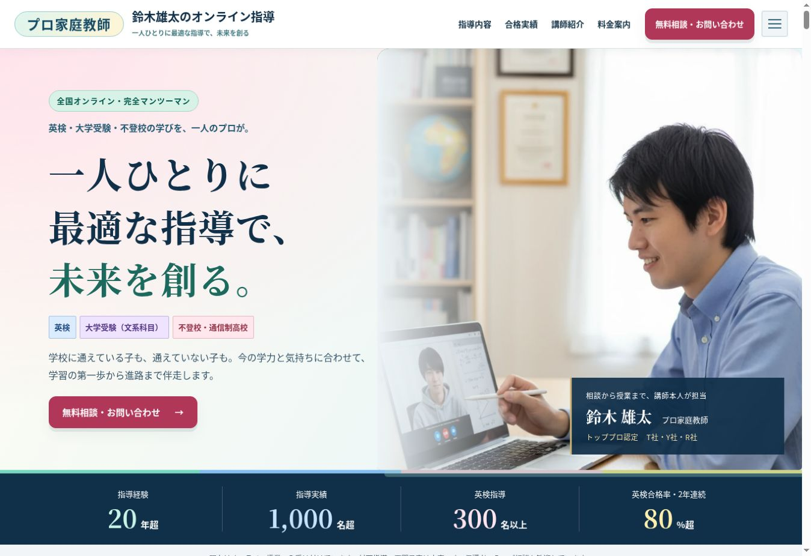
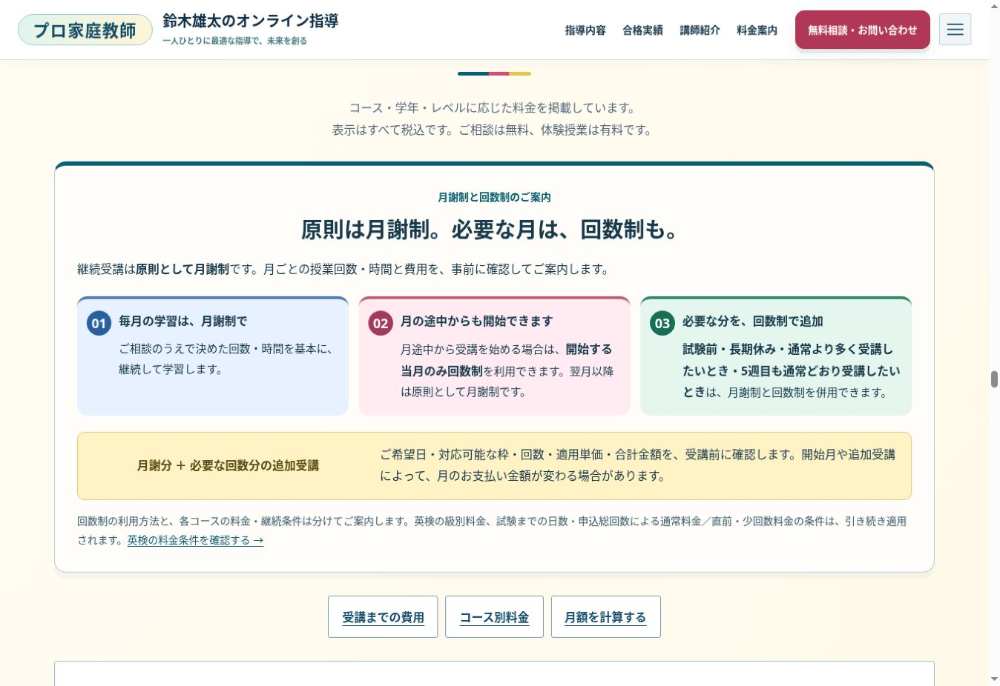

# 保護者目線の配色・視覚的階層の刷新

5サイトすべてを修正し、PR [#11](https://github.com/k0nan728-web/kateikyoshi-sogo-official/pull/11) をmainへ統合。本番実装コミットは `76df5a7874b4e1519aa11dca04f939f90b09a462`。Cloudflare Pages: **kateikyoshi-sogo** の公開成功、および実際の公開5ページで新デザインを確認しました。

## 改善内容

単一の青・緑が続く構成を見直し、62セクションを内容に合わせてスカイ、ミント、ローズ、ライラック、レモン、アイボリーで構成。濃紺の実績帯は残し、淡い背景との明暗差で読むリズムを作りました。

| サイト | 主な配色と役割 | 色彩・視覚的階層の暫定評価 前→後 |
|---|---|---:|
| 公式 | ローズの相談ボタン、ミント・ブルーの指導説明、四色の実績数字 | 88→94 |
| 英検 | ネイビーと教材写真、ライトブルーの相談、級別・指導内容の色分け | 88→94 |
| 逆転合格 | ブルーの主導線、ローズの悩み、ライラックの講師紹介 | 88→94 |
| 進路伴走 | グリーンのブランド、ミントの相談、ブルーの講師紹介と黄色の吹き出し | 88→94 |
| Re:大学受験 | パープルのブランド、レモンの相談、ローズ・ブルーの説明 | 88→94 |

数値は担当者の主観を含むデザイン評価で、成果や総合品質の保証ではありません。初回の項目別・総合評価と問題一覧は [総合監査記録](REPORT.md) に残しています。未検証事項があるため総合100点とは判定していません。

- 講師本人の写真に白いフレームと色の影、既存の吹き出しに黄色、資格・実績に色別の強調を追加。
- 月謝・月途中開始・追加受講をブルー／ローズ／ミント、合計費用の説明をレモンで区別。比較・支払い・申込・相談ページも同じ意図で調整。
- FAQの開いた状態、キーボードフォーカス、見出しと表の見やすさを改善。FAQのフォーカスが切れる状態も解消。
- 逆転の末尾は無料相談を主ボタンに変更。伴走はヘッダーを「無料で相談する」に変更し、末尾にも無料相談を追加。有料申込との区別を明確化。
- 新規画像・Webフォント・JavaScript・アニメーションは追加せず、既存写真とCSSを活用。

## 内容・条件の維持

9ページの表示文章を変更前と照合し、上記の伴走CTA変更を除き一致を確認。料金、実績、人数、早稲田を含む合格事例、講師情報、割引、申込条件は変更していません。実績の証明資料は求めず、創作・削除もしていません。今回新たに判断不能な内容の矛盾は発見していません。

「原則月謝制」「月途中開始は当該月のみ回数制」「試験前・長期休み・追加受講・5週目には併用可能」は維持。共通月謝案内6ページ・中途解約案内5ページの原稿完全一致検査も通過しています。

## 検証結果

最終提案版：[Actions 41648279235](https://github.com/k0nan728-web/kateikyoshi-sogo-official/actions/runs/41648279235)。

| 検証 | 結果 |
|---|---|
| 5サイト×6幅×Chromium/WebKit | 60ケース合格、横スクロール・画像欠損・JS例外なし |
| 全セクション描画後のaxe WCAG 2/2.1 A・AA | 10回、違反0件 |
| 隔離フォーム：相談・体験・通常×2エンジン | 6ケース合格。必須入力・失敗時保持・再試行・完了表示 |
| 料金計算：5週目、少回数、直前1.3倍、二重適用防止等 | 36ケース合格 |
| 既存フォーム配信・ポータル回帰テスト | CI合格。ポータル22テストを含む |
| ビルド・共通原稿・差分形式 | 合格 |
| 390pxの全5サイト画像・代表PC画像の目視 | 確認済み |
| 本番の5サイト・関連ページ・API公開設定・専用404等 | 25項目合格、失敗0件 |
| 実際の公開5ページ | デザイン版、62箇所の配色、相談リンク、幅超過なしを確認 |

本番検証：[Actions 41649639617](https://github.com/k0nan728-web/kateikyoshi-sogo-official/actions/runs/41649639617)。フォームの今回の回帰テストは架空データ・モックで実施し、追加メール送信はしていません。以前のTurnstile実認証・お問い合わせ実送信・Resend通知と自動返信の配信結果は総合監査記録を参照。

## 本番モバイルLighthouseの実測値

| サイト | Performance | Accessibility | Best Practices | SEO | LCP | CLS | TBT |
|---|---:|---:|---:|---:|---:|---:|---:|
| 公式 | 88 | 94 | 100 | 92 | 3.00秒 | 0 | 192ms |
| 英検 | 97 | 100 | 100 | 92 | 2.22秒 | 0 | 0ms |
| 逆転合格 | 98 | 100 | 100 | 92 | 2.36秒 | 0 | 0ms |
| 進路伴走 | 98 | 100 | 100 | 92 | 2.23秒 | 0 | 0ms |
| Re:大学受験 | 98 | 100 | 100 | 92 | 2.22秒 | 0 | 0ms |

ラボ測定は実利用者のCore Web Vitalsではなく、実行環境による変動があります。公式の速度には改善余地があります。

全サイトのSEO92はCloudflareが付加する `Content-Signal` をLighthouse 12.8.2が未認識と判定したものです。canonical・JSON-LD・robotsのHTTP応答は別途検証しています。サイト所有者の検索・AI利用ポリシーをスコア目的で変更していません。

公式のLighthouse Accessibility94では、画面外描画省略中のセクションを別セクションと重なっているものとして判定する箇所があります。全セクション描画後のaxeでは両エンジンとも違反0件です。生の94点はそのまま記録し、完全なWCAG適合と読み替えていません。

## 残る確認事項・復旧

実機iPhone Safari、実利用者のLCP/INP/CLS、すべての支援技術・日本語の孤立改行、正式契約書の法的適合性、体験・通常授業の実申込送信は未検証です。これらを合格扱いにしていません。

今回の変更は静的CSS・HTMLが中心で、Functions・秘密情報・メール配信設定・データベースは変更していません。復旧時は本実装コミットをrevertして再配信、またはCloudflareの既存正常デプロイに戻します。配色変更直前のmainは `c653f3e2dd48c2fbd4b2a38d764454ffff3cd8e3`。

機械可読記録：[colour-verification.json](colour-verification.json)。

公開後の公式ヒーロー：

公開後の月謝・回数制案内：

