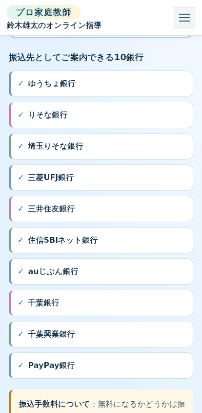

# iPhone XS Max相当幅での支払い案内の余白修正

所有者の実機スクリーンショットでは、公式サイト「料金のお支払い方法」の見出し・本文・枠が画面端に接していた。原因は、公式トップのセクション共通スタイルが支払い案内の左右余白を0に上書きしたこと。従来の横スクロール検査では、画面内に収まるが端に接する状態を検出できなかった。

PR [#12](https://github.com/k0nan728-web/kateikyoshi-sogo-official/pull/12) で、5サイト共通の支払い案内に `padding-inline:clamp(18px,4vw,32px)`、内枠に幅100%・最大1080pxを指定した。見出しは自然な折り返しを保ち、横方向を隠す処理や文字の縮小はしていない。9ページのHTMLはCSSの参照版のみ更新し、料金・規約・本文・申込処理は維持した。

実装コミット：`688c7195d5c53c666816b7b8b346ae34170ac81a`。公開検査は、新しいCSS参照版の配信を待ってから判定するように更新した（`53cb5b5175055f4412eac00d8f06b8511aee04f2`）。Cloudflare Pages の `kateikyoshi-sogo` 公開チェックは成功した。

| 検証 | 結果 |
|---|---|
| 5サイト×7幅（320/390/414/768/1024/1366/1920px）×Chromium/WebKit | 70表示ケース合格。横方向のはみ出し・画像欠損・JavaScript例外なし |
| 414pxの支払い案内の左右余白 | 全5サイト・両エンジンで左右それぞれ18px |
| 全セクション描画後のaxe WCAG 2/2.1 A・AA | 10回、違反0件 |
| フォームと料金計算の隔離テスト | フォーム6ケース、料金計算36ケース合格 |
| 共通原稿 | 月謝案内6ページ、中途解約案内5ページ一致 |
| 公開後の読取専用検査 | 5サイトが修正版CSSを参照。関連ページ・API・404を含む25項目、失敗0件 |
| 公開ページの直接確認 | 5サイトで修正版CSS・支払い案内の余白・画面幅超過なしを確認 |

[提案版の表示検査](https://github.com/k0nan728-web/kateikyoshi-sogo-official/actions/runs/41655399339)／[公開後の検査](https://github.com/k0nan728-web/kateikyoshi-sogo-official/actions/runs/41656705448)／[機械可読の検査値](iphone-payment-verification.json)。

以下は414pxのWebKit検査画面であり、実機iPhone Safariの再撮影ではない。所有者のiPhone XS Maxでの修正後の確認は未実施と区別する。

