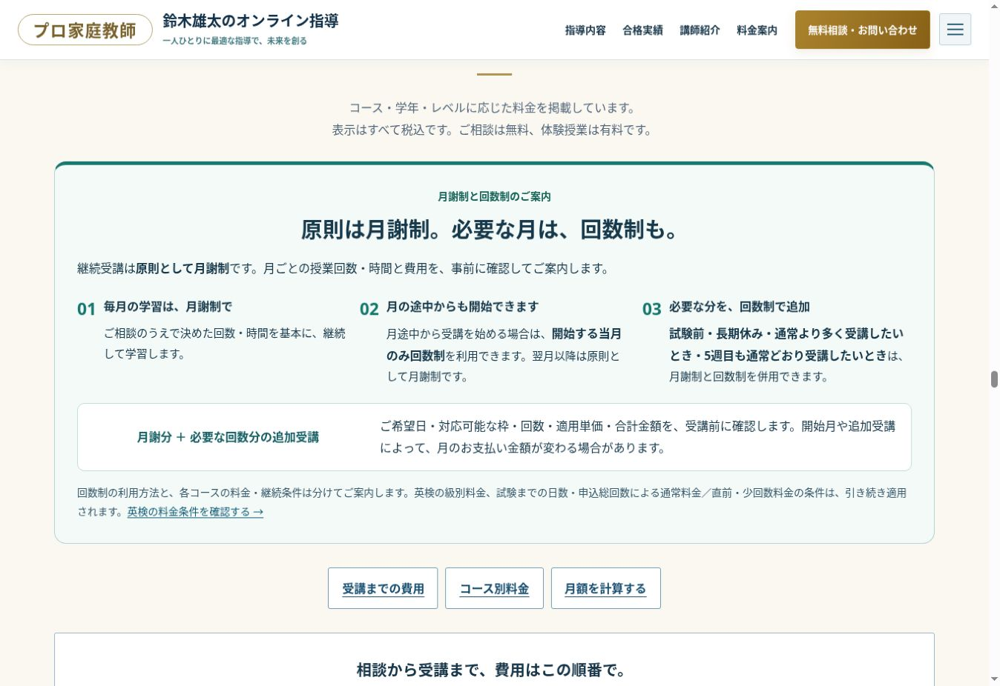

# 月謝制・回数制の案内追加（2026-11-03）

5サイトの料金欄に、次の受講制度を追加し、本番公開後に確認しました。

1. 継続受講は原則として月謝制。
2. 月途中から開始する場合は、開始する当月のみ回数制を利用できる。翌月以降は原則として月謝制。
3. 試験前・長期休み・通常より多く受講したい場合・5週目も通常どおり受講したい場合は、月謝制と回数制を併用できる。
4. 月謝分と追加受講分の回数・適用単価・合計を、受講前に確認する。

コースの単価、英検の学年不問・級別料金・申込総回数による1.3倍の条件、任意サポート・特典・中途解約の規定は変更していません。回数制を使うことだけを理由に、一律の新しい割増や割引を設定していません。

## 反映箇所

- 公式・英検・逆転合格・進路伴走・Re:大学受験：料金欄の3つの利用場面、支払い説明。
- お支払い案内 `/payment/`：同じ制度説明とFAQ。
- 比較ページ `/hikaku/`：料金試算前の案内。選択した回数を同条件で受講する試算であり、初月・追加分は別途費用確認する旨を明記。
- お申し込み：受講条件の確認欄と公式案内リンク。お問い合わせ：相談前の案内。
- 公式・比較の計算機：月5回の選択肢。比較から問い合わせへ月5回と大学受験の正式な区分名を引き継ぐ。

共通原稿は `tools/billing-policy.mjs` で6ページを同期・照合。比較ページの元Reactソースにも同じ案内・月5回を反映しました。

## 実装・公開

- PR #10：https://github.com/k0nan728-web/kateikyoshi-sogo-official/pull/10 （統合済み）
- 公開コミット：`262e8ba99b52142d990179411e7d0a9f8431738e`
- Cloudflare Pages `kateikyoshi-sogo`：公開成功。
- 比較元ソース：`k0nan728-web/prokatekyo-lesson-fee-source` の `3cc4d33335ab41b513e1ddb5bef0e57e7d04bf24`。

## 検証結果

- PR検証 https://github.com/k0nan728-web/kateikyoshi-sogo-official/actions/runs/41642499953 と本番ブランチの再検証 https://github.com/k0nan728-web/kateikyoshi-sogo-official/actions/runs/41643106873 ：全ジョブ成功。
- 320/390/768/1024/1366/1920px × Chromium/WebKit × 5サイト：60表示ケース。横スクロール・画像欠損・重複ID・アンカー・構造化データ・JavaScript例外を検査。
- 全セクション描画後のaxe WCAG 2/2.1 A/AA：10回、違反0件。
- 隔離フォーム：6ケース成功。料金計算・相談引継ぎ：36ケース成功。英検5級60分月5回20,000円は本番ブラウザーでも確認。
- 既存フォームの検証・配信テスト、請求機能22テスト：成功。今回、追加の実メールは送っていない。
- 公開後 https://github.com/k0nan728-web/kateikyoshi-sogo-official/actions/runs/41643106841 ：25件のGET確認、API有効/公開キー、専用404、5サイトの新制度版を確認。失敗0件。
- 本番ブラウザーで5サイトを再閲覧し、制度案内が各1箇所で表示されることと横スクロールなしを確認。比較ページの案内・月5回の選択肢も確認。

## 本番モバイルLighthouse

| サイト | Performance | LCP | TBT |
|---|---:|---:|---:|
| 公式 | 92 | 2.71秒 | 55ms |
| 英検 | 98 | 2.26秒 | 20ms |
| 逆転 | 98 | 2.35秒 | 0ms |
| 伴走 | 97 | 2.50秒 | 0ms |
| Re: | 98 | 2.34秒 | 0ms |

実利用者のCore Web Vitalsとは異なる単回のラボ測定で、点数には変動があります。公式LCPは今回2.5秒以内に達しておらず、達成済みとは扱いません。

Lighthouse accessibilityは公式94、英検・逆転100、伴走・Re:96。描画遅延中の料金表の白文字を、別セクションの背景と組み合わせて判定する例があり、全セクション描画後のaxe検査（違反0件）と区別して保存しています。SEOはCloudflare付加のContent-Signalを未知とする判定が残り92。点数のために所有者のAI関連設定は変更していません。

以前の監査と同じ検証基準を適用しました。実機iPhone Safari、実利用者のCore Web Vitals、正式契約書の法務確認等の留保は継続し、根拠なく総合100点とは評価していません。

